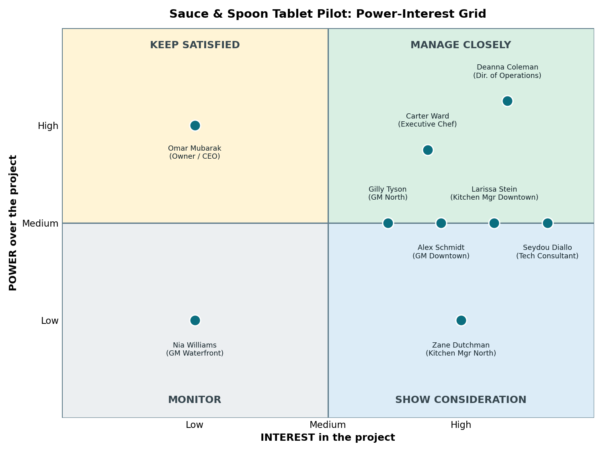

# Stakeholder Analysis: Sauce & Spoon Tabletop Menu Tablet Pilot

**Prepared by:** Morenikeji, Project Manager (project lead)
**Related documents:** project-charter.md (v1.6), smart-goals-analysis.md

## 1. Purpose

This analysis rates each stakeholder's **power** (how much influence they have and how much their actions affect the project outcome) and **interest** (how much the project's operations and outcomes affect their needs). The ratings decide how I engage each person: manage closely, keep satisfied, show consideration, or monitor.

Ratings are **H** (high), **M** (medium), or **L** (low). They are my judgment from the team bios, the organizational chart, the project team table, and the Week 1 meetings and emails. They will be revisited as the project progresses.

## 2. Stakeholder analysis

| Stakeholder | Role | Power | Interest | Why |
|---|---|---|---|---|
| **Omar Mubarak** | Owner and CEO; **Project Sponsor** | **H** | **L** | Most senior stakeholder, accountable for direction, profitability, and reputation, and his buy-in matters across projects. He is not involved in day-to-day operations and has a very busy schedule, so his attention is split. |
| **Deanna Coleman** | Director of Operations | **H** | **H** | Wrote the proposal, leads the vision, and oversees the managers. She set the goals (turn time, $75 average check) and decides on scope questions. Her high expectations and hands-on style mean she follows the project closely. |
| **Carter Ward** | Executive Chef | **H** | **H** | Has the final say on menu choices, so add-on and coupon promotions touch his authority. He runs a tight kitchen, is protective of his staff, and does not back down easily. Food waste, order returns, and kitchen morale all matter to him, and he has raised each of them. |
| **Gilly Tyson** | General Manager, North | **M** | **H** | Runs a pilot site and the staff who will use the tablets, so adoption depends on her. She has no authority over project goals or budget but has a strong voice. Her concerns include staff resistance, servers not fact-checking guests, and keeping front-of-house payroll. |
| **Alex Schmidt** | General Manager, Downtown | **M** | **H** | Runs the second pilot site and its staff. Alex raised kitchen capacity, payroll reallocation, and food waste. Alex is newer to the role and trained by Gilly, so they often align. |
| **Larissa Stein** | Kitchen Manager, Downtown | **M** | **H** | Runs day-to-day kitchen operations at a pilot site and controls costs and labor. She has experience from a Michelin-star kitchen, keeps a close eye on operations, and mentors Zane. Her buy-in carries weight with kitchen staff. |
| **Zane Dutchman** | Kitchen Manager, North | **L** | **H** | Runs the North kitchen day to day and is still learning the role. He has little authority over the project but feels the effects of faster turns directly, and can help with kitchen details. |
| **Seydou Diallo** | Restaurant Technology Consultant | **M** | **H** | Designs and implements the technology, so the integration depends on his work. He has no decision authority over goals or budget. It is his first major project and he wants it to succeed. |
| **Nia Williams** | General Manager, Waterfront | **L** | **L** | Her location is not in the pilot, so she has no authority over it and little direct interest for now. She becomes more relevant if the program is scaled to other locations. |

The project manager (Morenikeji) is the project lead and is not rated here.

### Other stakeholders (not plotted on the grid)

| Group | Power | Interest | Note |
|---|---|---|---|
| Bar staff (servers, food runners, bussers, hosts) | L | H | They use the tablets every shift and feel changes in workload and tips. Adoption depends on them. |
| Kitchen staff (cooks, prep, expo, dishwashers) | L | H | They feel the effect of faster turns and order changes. Turnover is already high. |
| Guests | L | M | They use the tablets and their reviews drive the 4.5/5 rating goal. |
| Terrific Tablets (vendor) | L | M | Supplies hardware, software, training materials, and maintenance. |

## 3. Power-interest grid

Stakeholders rated **medium** are placed on the line between boxes.

| | **Lower interest** | **Higher interest** |
|---|---|---|
| **Higher power** | **Keep satisfied:** Omar Mubarak | **Manage closely:** Deanna Coleman, Carter Ward |
| **Medium power (on the line)** | | **Between "manage closely" and "show consideration":** Gilly Tyson, Alex Schmidt, Larissa Stein, Seydou Diallo |
| **Lower power** | **Monitor:** Nia Williams | **Show consideration:** Zane Dutchman |

## 4. How I will engage each stakeholder

| Stakeholder | Approach | How |
|---|---|---|
| **Omar Mubarak** | Keep satisfied | Ask Deanna for an introduction and share the charter now to build rapport. After that, send short milestone updates (charter approval, go-live, results) and avoid detail. Bring him decisions only when they affect profitability or reputation. |
| **Deanna Coleman** | Manage closely | Regular check-ins (for example, weekly) and quick answers to her questions. Bring her the open decisions: payroll reallocation, the April start, the wait-time goal, and the appetizer targets. Her hands-on style means no surprises. |
| **Carter Ward** | Manage closely, with details delegated | Meet him early and involve him in decisions that touch the kitchen or menu, such as which items are promoted and the kitchen food-wait metric. Use Zane and Larissa for day-to-day kitchen details so Carter is not pulled into every decision. Keep the order-return policy and kitchen satisfaction items on a clear path (Appendix B of the charter), and ask him for the metrics he promised. |
| **Gilly Tyson** | Manage closely (strong partner) | She has a strong working relationship with me already. Involve her in the training plan, listen to her concerns about servers and front-of-house payroll, and ask her for baseline data. She can also help bring other GMs on board later. |
| **Alex Schmidt** | Manage closely (strong partner) | Involve Alex in kitchen capacity monitoring and the payroll discussion. Ask for baseline data and appetizer sales patterns. Keep Alex and Gilly informed together where possible so they stay aligned. |
| **Larissa Stein** | Keep informed and involve in details | Ask her early for input on kitchen impacts and kitchen metrics at Downtown. Her buy-in helps with Carter and the Downtown kitchen team. |
| **Zane Dutchman** | Show consideration | Keep him informed, check in often, and ask him for kitchen details at North. Give him support, since he is still learning the role. |
| **Seydou Diallo** | Keep closely informed (technical partner) | Work with him on the tablet package and the POS and host integration, and keep him informed of scope changes. Ask him to confirm vendor compatibility before selection. |
| **Nia Williams** | Monitor | Send occasional updates and pilot results. Involve her before any expansion to Waterfront, with Gilly and Alex helping. |

## 5. Key observations

1. **Sponsor and day-to-day owner are different people.** Omar is the Project Sponsor (high power, low interest), while Deanna drives the project (high power, high interest). I need to keep both informed, at very different levels of detail.
2. **The kitchen is the highest-risk relationship.** Carter has high power and high interest, is protective, and has already raised three issues (order returns, kitchen satisfaction, and payroll). Zane and Larissa are the route to practical kitchen input.
3. **The GMs make the pilot work.** Gilly and Alex have medium power and high interest. Their staff will use the tablets, and they have already shown some disagreement (appetizer targets, payroll).
4. **Future scale-up.** Nia and the other locations are low priority now but matter if the pilot succeeds.
